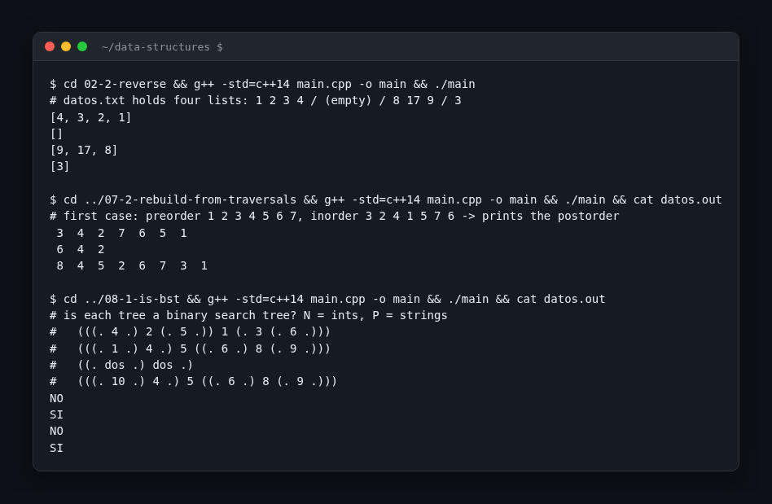

# Data Structures

Solved exercises from the Data Structures course (Estructuras de Datos) of the Computer Engineering degree at Universidad Complutense de Madrid.



## What it is

Each folder is one exercise from the course problem sheets. Most give you a linked list or a binary tree class and ask for one new operation: reverse the list, rebuild a tree from its traversals, say whether a tree is a search tree. The code was written in Visual Studio during the course and moved here with the IDE files removed.

## How it works

- Every program reads its cases from a text file in its folder (`datos.txt`, `datos.in`, `casos.txt`) and prints the answers to the console or to `datos.out`.
- The `#ifndef DOMJUDGE` block in each `main` is what the course's online judge uses to switch to standard input.
- `list_linked_*.h`, `stack_linkedlist.h` and `Header.h` hold the list, stack and `BinTree` classes handed out in class plus the method written for the exercise.

| Folder | What it does |
| --- | --- |
| `00-11-academia` | Students by level with `unordered_map`, `set` and `list`; no `main`, work in progress |
| `02-1-duplicate` | Singly linked list: insert a copy of every node right after it |
| `02-2-reverse` | Singly linked list: reverse it in place by relinking nodes |
| `02-3-merge` | Merge two sorted singly linked lists reusing the nodes |
| `02-4-intersection` | Keep only the values present in both sorted lists |
| `02-5-replicate` | Repeat or delete each element according to a second list of counts |
| `03-1-add-and-reorder` | Doubly linked list: add `m` to position `i` and keep the list sorted |
| `03-2-partition` | Doubly linked list: move everything at most a pivot in front of the rest |
| `03-3-intersection-double` | Intersection of two sorted doubly linked lists |
| `03-4-swap-pairs` | Doubly linked list: swap the nodes two by two |
| `04-1-balanced-brackets` | Stack: check that `()`, `[]` and `{}` in a line are balanced |
| `07-1-barrier`, `07-1-barrier-v2` | Binary tree: shallowest multiple of 7 with no prime on its path from the root, two takes |
| `07-2-rebuild-from-traversals` | Rebuild a binary tree from its preorder and inorder traversals |
| `08-1-is-bst` | Say whether a tree is a binary search tree (ints and strings) |
| `08-2-is-dense` | Check that an inorder walk gives consecutive integers |
| `08-3-rebuild-bst` | Rebuild a binary search tree from its preorder traversal |

## Stack

C++14, standard library only.

## Run it

```
cd 02-2-reverse
g++ -std=c++14 main.cpp -o main
./main
```

Any folder with a `main.cpp` builds the same way. `00-11-academia` has no `main`, so only `g++ -std=c++14 -c main.cpp` applies to it.
